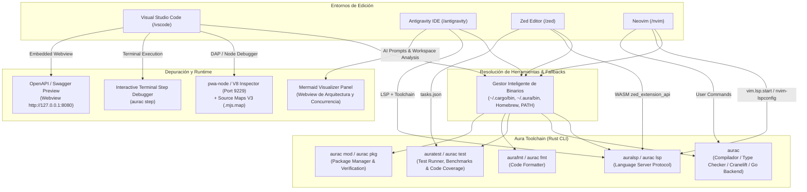

<p align="center">
  
</p>

# ⚡ Aura Language — Ecosistema de Soporte para Editores e IDEs

Bienvenido al repositorio oficial del ecosistema de extensiones y herramientas de edición para el lenguaje de programación **Aura** (`aurac`). Este monorepo alberga las integraciones de primera clase para los entornos de desarrollo más populares del ecosistema moderno:

* **[Visual Studio Code (`/vscode`)](#1-extensión-para-visual-studio-code-vscode)**: Extensión completa con Language Server Protocol (LSP), depuración interactiva con Source Maps V3, Test Explorer nativo con perfiles de ejecución y cobertura de código (`@test`, `@bench`, `-cover`), explorador interactivo de dependencias `aura.mod` con salto directo a archivo y verificación criptográfica `aura.lock` (SHA-256), resaltado TextMate para `aura.mod`/`aura.lock`, visor Swagger y tareas de compilación (Cranelift standalone, Go toolchain, release `-O3`, step debugger).
* **[Antigravity IDE (`/antigravity`)](#2-extensión-para-antigravity-ide-antigravity)**: Edición especializada con todas las capacidades de VS Code más integración profunda con agentes de Inteligencia Artificial (generación asistida de tests con `auratest`, refactorización a concurrencia CSP, refactorización a métodos con receptor estilo Go, generación de microservicios HTTP con `ServeMux`, diagnóstico asistido con auto-fix y visualizador arquitectónico interactivo para archivo activo o workspace completo con diagramas Mermaid).
* **[Zed Editor (`/zed`)](#3-extensión-para-zed-editor-zed)**: Extensión WebAssembly (WASM) en Rust mediante `zed_extension_api`, con soporte para `auralsp` y fallback a `aurac lsp`, coloreado sintáctico de alto rendimiento mediante Tree-sitter, navegación de símbolos (outline) para structs, interfaces y funciones, e integración de tareas de compilación, step debug, testing, cobertura y formateo.
* **[Neovim (`/nvim`)](#4-extensión-para-neovim-nvim)**: Plugin modular completo para Neovim en Lua (`require("aura").setup()`), con cliente LSP integrado con fallback nativo `vim.lsp.start` (Neovim 0.8+) o `nvim-lspconfig`, resaltado sintáctico nativo Vim (`syntax/aura.vim`, `syntax/auramod.vim`, `syntax/auralock.vim`), detección de archivos (`ftdetect`), reglas de sangría (`indent`), snippets de código y comandos de usuario enriquecidos (`:AuraRun`, `:AuraStep`, `:AuraBuild`, `:AuraCheck`, `:AuraTest`, `:AuraTestFile`, `:AuraCoverage`, `:AuraBench`, `:AuraFormat`, `:AuraSwagger`, `:AuraModTidy`, `:AuraModVerify`, `:AuraModVendor`).

---

## 🚀 Nuevas Características del Lenguaje Aura Soportadas

Todas las extensiones han sido actualizadas para dar soporte integral a las características del compilador Aura:

| Característica | Sintaxis en Aura | Soporte en Editores |
| :--- | :--- | :--- |
| **Estructuras de Dominio (`struct`)** | `struct User { name: String, age: Int };` | Resaltado, autocompletado, hover, outline y snippets |
| **Structs Compactos (`packed`)** | `export packed struct Header { magic: Int, ver: Byte };` | Alineación binaria Zig, resaltado y validación de tipos |
| **Métodos con Receptor (Go Model)** | `fn (u: *User) UpdateName(n: String): Unit => ...` | Resaltado de receptor valor/puntero, hover, jump to def |
| **Interfaces Estructurales (Duck Typing)** | `export interface Reader { Read(buf: List<Byte>): Int; }` | Tipado implícito Go-style, análisis de interfaces |
| **Directivas de Compilación (`build tags`)** | `//aura:build (linux && amd64) || darwin` | Coloreado de directivas, evaluación condicional |
| **Concurrencia CSP** | `spawn { ... }`, `routine { ... }`, `go { ... }` | Concurrencia de fibras, operadores de canal `<-`, `select` |
| **Sincronización de Hilos** | `sync.Mutex`, `sync.RWMutex`, `sync.WaitGroup` | Resaltado de tipos stdlib, snippets con `defer mu.unlock()` |
| **Servidor HTTP Nativo (`net/http`)** | `let mux = http.newServeMux();` | Enrutamiento dinámico, middleware, Swagger preview |
| **Limpieza Determinista (`defer` / `errdefer`)** | `defer file.close();`, `errdefer tx.rollback();` | Flujo LIFO y control de errores modelo Zig |
| **Incrustación de Recursos (`embed`)** | `embed("assets/page.html")`, `embedBytes("font.bin")` | Incrustación de archivos estáticos en tiempo de compilación |
| **Colecciones Literales** | `#{ "k" => v }` (Map), `#[ 1, 2, 3 ]` (Set) | Tokenización precisa y delimitadores de colecciones |
| **Gestión Descentralizada de Módulos** | `aura.mod` + `aura.lock` (SHA-256 tree hashing) | Coloreado sintáctico, TreeView en IDE, verificación de firmas, tareas tidy/vendor |

---

## 🗺️ Arquitectura General del Ecosistema



---

## 📁 Estructura del Repositorio

```text
aura-extentions/
├── .github/
│   └── workflows/
│       └── ci.yml                # CI/CD: Validación y compilación de VS Code, Antigravity y Zed
├── antigravity/                  # Extensión especializada para Google Antigravity IDE
│   ├── src/
│   │   ├── aiCommands.ts         # Integraciones de IA (tests, CSP, receivers, HTTP, Mermaid multi-archivo)
│   │   ├── debug.ts              # Adaptador de depuración con Source Maps V3
│   │   ├── dependencyExplorer.ts # TreeView interactivo con salto directo a línea de aura.mod / aura.lock
│   │   ├── extension.ts          # Activación, menú interactivo y comandos
│   │   ├── hover.ts              # Catálogo exhaustivo de hover, tipos nativos y Go to Definition
│   │   ├── swaggerPreview.ts     # Webview para previsualización OpenAPI / Swagger
│   │   ├── taskProvider.ts       # Integración con tareas estándar de build/test/coverage/fmt/mod
│   │   ├── testController.ts     # Controlador nativo de tests y cobertura de código
│   │   └── utils.ts              # Resolución de binarios (~/.cargo/bin, Homebrew, fallback a aurac)
│   ├── syntaxes/                 # Gramáticas TextMate para Aura (.aura), aura.mod y aura.lock
│   ├── snippets/                 # Colección completa de plantillas de código para Aura
│   ├── language-configuration.json
│   ├── package.json
│   └── tsconfig.json
│
├── vscode/                       # Extensión oficial para Visual Studio Code
│   ├── src/                      # Componentes LSP, Hover, Debug, Tasks, Tests, Dependencies, Utils
│   ├── syntaxes/                 # Gramáticas TextMate (.aura, aura.mod, aura.lock)
│   ├── snippets/                 # Snippets sincronizados
│   ├── language-configuration.json
│   ├── package.json
│   └── tsconfig.json
│
├── zed/                          # Extensión oficial para Zed Editor (Rust + WebAssembly)
│   ├── src/
│   │   └── lib.rs                # Implementación en Rust del trait zed::Extension
│   ├── languages/aura/
│   │   ├── config.toml           # Configuración del lenguaje, sangrías y auto-cierre
│   │   ├── highlights.scm        # Queries Tree-sitter actualizadas para todas las keywords y tipos
│   │   ├── outline.scm           # Queries Tree-sitter para structs, interfaces y funciones
│   │   ├── indents.scm           # Queries Tree-sitter para auto-indentación
│   │   └── brackets.scm          # Consultas para auto-cierre de corchetes y literales
│   ├── extension.toml            # Manifiesto de la extensión para Zed
│   ├── tasks.json                # Tareas de build, step debug, testing, cobertura, fmt y mod
│   └── Cargo.toml
│
├── nvim/                         # Plugin completo para Neovim (Lua)
│   ├── aura.lua                  # Punto de entrada rápido standalone
│   ├── lua/aura/
│   │   ├── init.lua              # Configuración general y registro de filetypes
│   │   ├── lsp.lua               # Configuración con fallback nativo vim.lsp.start o nvim-lspconfig
│   │   └── commands.lua          # Comandos (:AuraRun, :AuraStep, :AuraTest, :AuraCoverage, :AuraSwagger)
│   ├── syntax/
│   │   ├── aura.vim              # Resaltado sintáctico nativo Vim para código Aura
│   │   ├── auramod.vim           # Resaltado sintáctico nativo Vim para aura.mod
│   │   └── auralock.vim          # Resaltado sintáctico nativo Vim para aura.lock
│   ├── ftdetect/aura.vim         # Detección automática para *.aura, aura.mod y aura.lock
│   ├── indent/aura.vim           # Reglas de sangría inteligente
│   ├── snippets/aura.snippets    # Snippets compatibles con Snipmate y LuaSnip
│   └── README.md                 # Documentación y ejemplos de integración con lazy.nvim / packer
│
├── package.json                  # Scripts del Monorepo (compile, check:all, package:all)
└── .gitignore                    # Reglas limpias de exclusión de artefactos de compilación
```

---

## 1. Extensión para Visual Studio Code (`/vscode`)

La extensión para VS Code (`aura-vscode`, v0.2.0) ofrece una suite completa de herramientas para desarrolladores:

### 1.1 Resaltado Sintáctico y Gramática TextMate
- **Directivas de Compilación**: Reconocimiento de `//aura:build` y `//go:build`.
- **Métodos con Receptor**: Reconocimiento de `fn (self: Type) Method()` y `fn (self: *Type) Method()`.
- **Structs y Packed Structs**: Declaración de estructuras de dominio con campos fuertemente tipados.
- **Colecciones Literales**: Mapas asociativos `#{ "key" => value }` y conjuntos `#[ 1, 2 ]`.
- **Archivos de Módulo y Bloqueo**: Resaltado dedicado para `aura.mod` (`source.auramod`) y `aura.lock` (`source.auralock`).

### 1.2 Catálogo de Documentación y Go To Definition (`src/hover.ts`)
- Más de 1,500 líneas de catálogo técnico detallando palabras clave, operadores funcionales (`|>`, `<-`, `=>`, `?`), tipos nativos (`Int`, `Float`, `Channel`, `Mutex`, `ServeMux`, `Context`) y módulos de la biblioteca estándar (`http`, `sync`, `os`, `time`, `json`).
- Análisis estático del código del proyecto en tiempo real para saltar con `F12` a declaraciones de structs, funciones receptoras y módulos importados.

### 1.3 Test Controller, CodeLens y Ejecución de Pruebas (`src/testController.ts`, `src/codeLens.ts`)
- **Descubrimiento Inteligente**: Detecta archivos `*_test.aura` y funciones `@test`, `@bench`, `test_*`, `Test*`, `benchmark_*`, distinguiendo pruebas unitarias (`🧪`) de benchmarks de rendimiento (`⚡`).
- **CodeLens Interactivo**: Muestra `Run File Tests` al inicio del archivo y botones individuales `Run Test` / `Run Benchmark` sobre cada función de prueba para ejecución focalizada con `-run` y `-bench`.
- **Ejecución Inteligente de Archivos**: Detecta automáticamente si el archivo activo es `*_test.aura` y lo ejecuta con `auratest -v` en lugar de `aurac run`. Incluye acciones en la barra de herramientas del editor y menú contextual.
- **Perfil de Ejecución con Cobertura**: Ejecuta pruebas con análisis de cobertura en un solo clic (`auratest -cover`).
- **Resistencia**: Manejo robusto de comentarios, decoradores y líneas en blanco sin perder asociaciones de funciones.

### 1.4 Tareas Preconfiguradas (`src/taskProvider.ts`)
Accesibles desde **Terminal > Run Task...**:
1. **Build Standalone Native Binary (Cranelift)**: Compilación nativa directa a código de máquina.
2. **Build Release Standalone Binary (-O3, SIMD)**: Binario optimizado para máxima velocidad y strip de símbolos.
3. **Build Native Executable via Go Toolchain**: Compilación vía backend Go.
4. **Type Check Active File (aurac check)**: Verificación estática ultra-rápida sin emitir binarios.
5. **Run Active File (aurac run)**: Ejecución directa.
6. **Step Debug Active File (aurac step)**: Depurador interactivo paso a paso en terminal.
7. **Run Active Test File (*_test.aura)**: Ejecución interactiva del archivo de test activo (`auratest -v`).
8. **Run Test Suite (auratest / aurac test)**: Ejecución de tests unitarios y de integración.
9. **Run Test Suite with Code Coverage (auratest -cover)**: Análisis de cobertura de código.
10. **Generate HTML Coverage Report**: Generación de reporte interactivo `coverage.html`.
11. **Run Benchmarks (aurac test --bench)**: Ejecución de pruebas de rendimiento.
12. **Format Workspace (aurafmt -w .)**: Formateo estandarizado de todo el proyecto.
13. **Module Tidy / Verify / Vendor**: Gestión completa de dependencias de `aura.mod` y verificación criptográfica de `aura.lock`.

### 1.5 Explorador Interactivo de Dependencias (`src/dependencyExplorer.ts`)
- Muestra el nombre del módulo y la versión de Aura.
- **Navegación al Hacer Clic**: Al hacer clic en un módulo o dependencia, salta directamente a la línea correspondiente en `aura.mod`.
- Al hacer clic en `aura.lock`, abre el archivo de bloqueo criptográfico con hashes SHA-256.
- Lista dependencias declaradas en `require (...)` indicando con un icono de seguridad si el hash SHA-256 está verificado en `aura.lock`.

### 1.6 Previsualización OpenAPI / Swagger (`src/swaggerPreview.ts`)
- Permite abrir un panel Webview interactivo (`vscode.ViewColumn.Beside`) apuntando a `http://127.0.0.1:<port>/swagger` para explorar y probar rutas HTTP y microservicios Aura en vivo.

---

## 2. Extensión para Antigravity IDE (`/antigravity`)

La extensión para **Google Antigravity IDE** (`aura-antigravity`, v0.2.0) expande las funciones de VS Code integrando flujos con agentes de Inteligencia Artificial:

### Comandos de IA Disponibles:
1. **Aura AI: Generate Tests (`auratest`)**: Genera suites completas de pruebas unitarias y benchmarks con `@test`, `assert_eq` y casos de borde.
2. **Aura AI: Refactor to CSP Concurrency**: Transforma código secuencial o con callbacks en concurrencia CSP con `spawn`, canales tipados y `select`.
3. **Aura AI: Refactor to Go-Style Struct Methods**: Transforma estructuras procedurales en structs de dominio con métodos receptores y duck typing.
4. **Aura AI: Generate Backend HTTP Microservice**: Crea microservicios backend completos con `http.newServeMux()`, middleware, JSON parsing y `sync.Mutex`.
5. **Aura AI: Explain Type & Exhaustiveness**: Analiza tipos algebraicos y genera esqueletos de coincidencia exhaustiva con `match`.
6. **Aura AI: One-Click Fix Compiler Diagnostics**: Corrige errores del compilador o del comprobador de tipos basándose en los diagnósticos activos.
7. **Aura AI: Architecture & Concurrency Visualizer**: Abre un panel interactivo con diagramas Mermaid en tiempo real con soporte para visualizar el **archivo activo** o el **workspace completo**, mostrando módulos, structs, interfaces, métodos y canales concurrentes.

---

## 3. Extensión para Zed Editor (`/zed`)

Implementada en Rust sobre `zed_extension_api`:
- **WASM Extension**: Detección y ejecución de `auralsp` con fallback automático a `aurac lsp` y soporte para `target/release`, `target/debug` y PATH del sistema.
- **Tree-sitter Queries**: Resaltado sintáctico completo en `highlights.scm`, navegación de esquema en `outline.scm`, auto-indentación en `indents.scm` y auto-cierre de delimitadores en `brackets.scm`.
- **Tareas Integradas (`tasks.json`)**: Ejecución con un clic de build nativo Cranelift, build Go, depuración paso a paso en terminal, tests unitarios, cobertura de código, benchmarks, watch mode, formateo y gestión de módulos.

---

## 4. Extensión para Neovim (`/nvim`)

Plugin moderno para Neovim en Lua con soporte para administradores como `lazy.nvim` o `packer.nvim`, y funcionamiento sin dependencias obligatorias gracias al fallback nativo `vim.lsp.start`:

```lua
-- En tu configuración de lazy.nvim:
{
  "aura-lang-developer/aura-extentions",
  dir = "/path/to/aura-extentions/nvim",
  ft = { "aura", "auramod", "auralock" },
  config = function()
    require("aura").setup({
      lsp = {
        enable = true,
        inlay_hints = true,
        format_on_save = false,
      },
    })
  end,
}
```

Para una integración rápida en un solo archivo sin gestor de plugins, también se incluye el script autónomo [nvim/aura.lua](file:///Users/mavro/Projects/AuraProjects/editors/nvim/aura.lua).

### Comandos de Usuario en Neovim:
- `:AuraRun [file]` — Compila y corre el archivo actual (detecta automáticamente si es `*_test.aura` y ejecuta `auratest -v`).
- `:AuraStep [file]` — Inicia el depurador paso a paso en la terminal interactiva.
- `:AuraBuild [--release]` — Construye un binario ejecutable nativo.
- `:AuraCheck` — Comprueba tipos con `aurac check`.
- `:AuraTest [flags]` — Corre tests con `auratest` o `aurac test`.
- `:AuraTestFile` — Corre únicamente las pruebas del archivo activo (`auratest -v`).
- `:AuraCoverage [flags]` — Corre tests con análisis de cobertura y genera reporte HTML.
- `:AuraBench` — Corre benchmarks de rendimiento.
- `:AuraFormat` — Formatea con `aurafmt` o `aurac fmt`.
- `:AuraSwagger [port]` — Abre la previsualización OpenAPI / Swagger en el navegador.
- `:AuraModTidy`, `:AuraModVerify`, `:AuraModVendor` — Administra módulos y dependencias.

---

## 📊 Matriz Comparativa de Capacidades por Editor

| Característica | VS Code | Antigravity IDE | Zed Editor | Neovim |
| :--- | :---: | :---: | :---: | :---: |
| **Language Server Protocol (`auralsp` / `aurac lsp`)** | ✅ Sí | ✅ Sí | ✅ Sí | ✅ Sí (Nativo / lspconfig) |
| **Hover Enriquecido con Catálogo Estándar** | ✅ Sí | ✅ Sí | Vía LSP | Vía LSP |
| **Go To Definition (`F12` / `gd`)** | ✅ Sí (Multi-archivo) | ✅ Sí (Multi-archivo) | ✅ Sí | ✅ Sí |
| **Depuración con Breakpoints & Source Maps** | ✅ Sí (`pwa-node`) | ✅ Sí (`pwa-node`) | ✅ Sí (DAP / V8) | Vía nvim-dap |
| **Depuración Paso a Paso en Terminal (`aurac step`)** | ✅ Sí | ✅ Sí | ✅ Sí (Tarea) | ✅ Sí (`:AuraStep`) |
| **Test Explorer & Benchmarks** | ✅ Sí (Nativo) | ✅ Sí (Nativo) | Vía Tareas | Vía Comandos |
| **Análisis de Cobertura de Código (`-cover`)** | ✅ Sí (Nativo) | ✅ Sí (Nativo) | Vía Tareas | ✅ Sí (`:AuraCoverage`) |
| **Tareas de Build / Check / Format / Mod** | ✅ Sí (`taskProvider`) | ✅ Sí (`taskProvider`) | ✅ Sí (`tasks.json`) | ✅ Sí (User Commands) |
| **Explorador Interactivo de Dependencias (`aura.mod`)** | ✅ Sí (Con salto a línea) | ✅ Sí (Con salto a línea) | ❌ | ❌ |
| **Resaltado de `aura.mod` y `aura.lock`** | ✅ Sí (TextMate) | ✅ Sí (TextMate) | Vía Tree-sitter | ✅ Sí (Vim Syntax) |
| **Previsualizador OpenAPI / Swagger** | ✅ Sí (Webview) | ✅ Sí (Webview) | ❌ | ✅ Sí (`:AuraSwagger`) |
| **Agentes IA: Generación de Tests y Benchmarks** | ❌ | ✅ Sí | ❌ | ❌ |
| **Agentes IA: Refactorización a CSP y Struct Methods** | ❌ | ✅ Sí | ❌ | ❌ |
| **Agentes IA: Generación de Microservicio HTTP** | ❌ | ✅ Sí | ❌ | ❌ |
| **Agentes IA: Auto-Fix de Diagnósticos** | ❌ | ✅ Sí | ❌ | ❌ |
| **Agentes IA: Visualizador Arquitectónico Mermaid** | ❌ | ✅ Sí (Archivo / Workspace) | ❌ | ❌ |
| **Motor de Resaltado Sintáctico** | TextMate Grammar | TextMate Grammar | Tree-sitter | Vim Syntax / Tree-sitter |

---

## 🛠️ Comandos Globales del Monorepo

Desde la raíz del repositorio puedes ejecutar:

```bash
# Compilar extensiones TypeScript (VS Code y Antigravity)
npm run compile

# Validar TypeScript y Rust (cargo check) en todo el monorepo
npm run check:all

# Empaquetar artefactos VSIX para distribución
npm run package:all
```

---

## 📜 Licencia

Este proyecto se distribuye bajo la licencia **MIT**. Consulta los archivos `LICENSE` en cada subcarpeta para más detalles.
