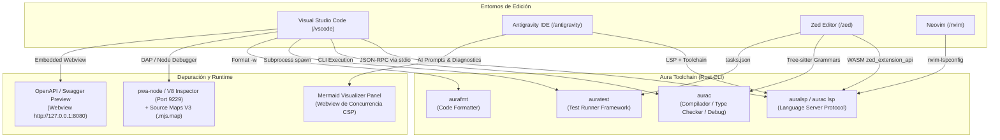
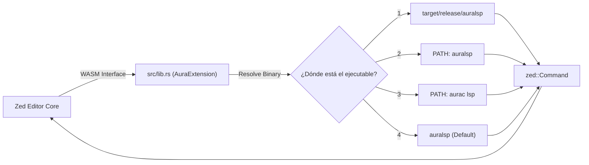

# ⚡ Aura Language — Ecosistema de Soporte para Editores e IDEs

Bienvenido al repositorio oficial del ecosistema de extensiones y herramientas de edición para el lenguaje de programación **Aura** (`aurac`). Este repositorio monorepo alberga las integraciones de primera clase para los entornos de desarrollo más populares del ecosistema moderno:

* **[Visual Studio Code (`/vscode`)](#1-extensión-para-visual-studio-code-vscode)**: Extensión completa basada en el Language Server Protocol (LSP), depuración interactiva con Source Maps V3, Test Explorer nativo, explorador de dependencias `aura.mod`, visor Swagger y tareas de compilación.
* **[Antigravity IDE (`/antigravity`)](#2-extensión-para-antigravity-ide-antigravity)**: Edición especializada con todas las capacidades de VS Code más integración profunda con agentes de Inteligencia Artificial (generación asistida de tests, refactorización CSP, diagnóstico asistido con auto-fix y visualizador arquitectónico interactivo con diagramas Mermaid).
* **[Zed Editor (`/zed`)](#3-extensión-para-zed-editor-zed)**: Extensión compilada en WebAssembly (WASM) en Rust a través de `zed_extension_api`, con soporte para `auralsp`, coloreado sintáctico de alto rendimiento mediante Tree-sitter, navegación de símbolos de esquema (outline) y tareas integradas.
* **[Neovim (`/nvim`)](#4-configuración-para-neovim-nvim)**: Configuración nativa en Lua basada en `nvim-lspconfig` y el cliente LSP integrado de Neovim (`vim.lsp`), con mapeos de teclado inmediatos para hover, definición, formateo y renombrado.

---

## 🗺️ Arquitectura General del Ecosistema

A continuación se ilustra cómo interactúan los diferentes editores con el compilador, servidor de lenguaje y herramientas CLI de Aura:



---

## 📁 Estructura del Repositorio

```text
editors/
├── antigravity/                  # Extensión de Aura para Google Antigravity IDE
│   ├── src/
│   │   ├── aiCommands.ts         # Integraciones exclusivas de IA y visualizador Mermaid
│   │   ├── debug.ts              # Configuración y adaptador de depuración con Source Maps
│   │   ├── dependencyExplorer.ts # TreeView para dependencias declaradas en aura.mod
│   │   ├── extension.ts          # Punto de entrada de activación y comandos
│   │   ├── hover.ts              # Catálogo exhaustivo de hover y Go to Definition
│   │   ├── swaggerPreview.ts     # Webview para previsualización OpenAPI / Swagger
│   │   ├── taskProvider.ts       # Integración con tareas estándar de build/test/fmt
│   │   └── testController.ts     # Controlador nativo de pruebas (Test Explorer)
│   ├── syntaxes/                 # Gramática TextMate para syntax highlighting
│   ├── snippets/                 # Colección de plantillas de código para Aura
│   ├── language-configuration.json
│   ├── package.json
│   └── tsconfig.json
│
├── vscode/                       # Extensión oficial para Visual Studio Code
│   ├── src/                      # Componentes idénticos a antigravity (sin capa de IA)
│   ├── syntaxes/
│   ├── snippets/
│   ├── language-configuration.json
│   ├── package.json
│   └── tsconfig.json
│
├── zed/                          # Extensión oficial para Zed Editor (Rust + WASM)
│   ├── src/
│   │   └── lib.rs                # Implementación en Rust del trait zed::Extension
│   ├── languages/aura/
│   │   ├── config.toml           # Configuración del lenguaje, sangrías y delimitadores
│   │   ├── highlights.scm        # Queries Tree-sitter para coloreado sintáctico
│   │   ├── outline.scm           # Queries Tree-sitter para el navegador de símbolos
│   │   ├── indents.scm           # Queries Tree-sitter para auto-indentación
│   │   └── brackets.scm          # Consultas para auto-cierre de corchetes
│   ├── extension.toml            # Manifiesto de la extensión para Zed
│   ├── tasks.json                # Tareas de ejecución, verificación y testing
│   └── Cargo.toml
│
└── nvim/                         # Configuración ligera para Neovim
    └── aura.lua                  # Script Lua con nvim-lspconfig y keybindings
```

---

## 1. Extensión para Visual Studio Code (`/vscode`)

La extensión para VS Code (`aura-vscode`, v0.2.0) ofrece una suite completa de herramientas para desarrolladores, permitiendo escribir, probar, ejecutar, formatear y depurar aplicaciones en Aura.

### 1.1 Arquitectura y Ciclo de Vida (`src/extension.ts`)

El archivo [extension.ts](file:///Users/mavro/Projects/AuraProjects/editors/vscode/src/extension.ts) orquesta todos los subsistemas del plugin.

#### Funciones Principales:
* **`resolveBinary(binaryName: string, configPathKey: string): string`**:
  Resuelve dinámicamente la ruta absoluta a los ejecutables de la toolchain (`auralsp`, `aurac`, `auratest`, `aurafmt`). Su orden de evaluación es:
  1. Si el usuario configuró una ruta explícita en `aura.<configPathKey>` (ej. `aura.compiler.path`), se utiliza esa ruta.
  2. Busca en las carpetas del espacio de trabajo abierto las rutas de compilación local de Cargo: `target/release/<binaryName>` o `target/debug/<binaryName>`. Esto permite desarrollar la toolchain de Aura y probarla inmediatamente sin necesidad de instalarla globalmente.
  3. Si no se halla localmente, delega al nombre del binario esperando encontrarlo en el `$PATH` del sistema operativo.
* **`getAuraTerminal(): vscode.Terminal`**:
  Garantiza la reutilización de una única terminal interactiva dedicada ("Aura") en VS Code para la ejecución de comandos CLI, evitando saturar la interfaz de terminales redundantes.
* **`activate(context: vscode.ExtensionContext)`**:
  Inicializa y registra:
  - El cliente LSP (`LanguageClient`) mediante stdio contra `auralsp`.
  - El indicador de estado (`statusBarItem`) en la esquina inferior derecha con estados reactivos (`starting`, `ready`, `error`).
  - Los proveedores de Hover y Definición (`AuraHoverProvider`, `AuraDefinitionProvider`).
  - El proveedor de depuración (`AuraDebugConfigurationProvider`).
  - El menú de acciones rápidas (`aura.showMenu`) mediante `showQuickPick`.
  - Los comandos del sistema (ejecución, verificación, formato, watch mode, Swagger, etc.).
  - El controlador de pruebas (`createAuraTestController`).
  - El proveedor de tareas de build (`AuraTaskProvider`).
  - El explorador de dependencias de `aura.mod` (`AuraDependenciesProvider`).
* **`updateStatusBar(status: 'starting' | 'ready' | 'error')`**:
  Modifica dinámicamente el icono y tooltip de la barra de estado según el ciclo de vida del LSP daemon.
* **`deactivate(): Thenable<void> | undefined`**:
  Detiene de forma segura el proceso del servidor de lenguaje al cerrar el editor.

---

### 1.2 Catálogo de Documentación, Hover y Go To Definition (`src/hover.ts`)

El archivo [hover.ts](file:///Users/mavro/Projects/AuraProjects/editors/vscode/src/hover.ts) (más de 1,300 líneas de código) implementa un motor híbrido de documentación contextual y análisis estático local que complementa al LSP.

#### Estructuras de Datos:
* **`HoverDoc`**: Define la estructura de un tooltip de documentación enriquecido (título, categoría, firma, descripción, parámetros tipados, valor de retorno, campos de struct, variantes de tipos suma, ejemplos de código, tips de rendimiento/seguridad y archivo/línea de origen).
* **`ExtractedSymbol`**: Representa un símbolo extraído del código fuente (`function`, `type`, `interface`, `variable`, `import`).
* **`ImportSpecifier`**: Metadatos de declaraciones de importación (`import { foo } from "./bar"`).
* **`ParsedDocumentCache`**: Almacena en memoria los símbolos e importaciones de un archivo junto con su `mtime` (timestamp de modificación) para invalidación ultrarrápida.

#### Base de Datos Integrada (`HOVER_DATABASE`):
Posee documentación técnica completa para:
* **Palabras Clave**: `fn`, `let`, `mut`, `const`, `type`, `interface`, `match`, `when`, `spawn`, `select`, `defer`, `errdefer`, `panic`, `recover`, `embed`, etc.
* **Tipos Nativos y Concurrencia**: `Int`, `Float`, `String`, `Bool`, `Option<T>`, `Result<T, E>`, `Channel<T>`, `Context`, `WaitGroup`, `Mutex`.
* **Operadores Funcionales**: `|>` (pipeline), `<-` (comunicación de canales), `=>` (fat arrow para closures y match), `?` (propagación de errores `Result`/`Option`).
* **Decoradores**: `@test`, etc.

#### Funciones y Componentes:
* **`createMarkdownHover(doc: HoverDoc): vscode.Hover`**:
  Construye un `vscode.MarkdownString` estilizado con etiquetas de colores, bloques de código, tablas de parámetros con tipos, valores de retorno, ejemplos interactivos y consejos de optimización.
* **`extractDocComments(lines: string[], targetLineIdx: number): string | undefined`**:
  Extrae comentarios de documentación precedentes (`///` o bloques `/** ... */`) para renderizarlos en la ayuda contextual.
* **`parseAuraSource(content: string, filePath: string): ParsedDocumentCache`**:
  Analizador léxico y sintáctico ligero que extrae firmas de funciones, tipos registro (`type User = { ... }`), tipos suma/algebraicos con variantes (`type Color = | Red | Blue`), interfaces con métodos, constantes y variables.
* **`getDocumentCache(filePath: string, textOverride?: string): ParsedDocumentCache | undefined`**:
  Capa de caché de alto rendimiento con validación mediante `fs.statSync(filePath).mtimeMs`.
* **`resolveModuleFilePath(currentFilePath: string, modulePath: string): string | undefined`**:
  Resuelve rutas de módulos relativos (`./auth`, `../models`) y módulos de workspace.
* **`resolveUnderlyingImport(...)`**:
  Rastrea recursivamente definiciones exportadas a través de diferentes archivos del proyecto.
* **`AuraHoverProvider`**:
  Implementa `vscode.HoverProvider`. Al posar el cursor sobre cualquier identificador:
  1. Inspecciona si el símbolo es una variable, función o tipo local en el archivo actual.
  2. Verifica si proviene de un archivo importado, mostrando su documentación de origen.
  3. Si es un módulo importado, detalla el módulo y sus símbolos exportados.
  4. Si coincide con la base de datos central de Aura, muestra la especificación estándar del lenguaje.
* **`AuraDefinitionProvider`**:
  Implementa `vscode.DefinitionProvider`. Permite usar `F12` ("Ir a la definición") para saltar de inmediato a:
  - Declaraciones de funciones locales o externas.
  - Tipos algebraicos, variantes de enumeraciones e interfaces.
  - Archivos de módulos en sentencias `import ... from "./ruta"`.

---

### 1.3 Motor de Depuración Interactiva y Source Maps (`src/debug.ts`)

El archivo [debug.ts](file:///Users/mavro/Projects/AuraProjects/editors/vscode/src/debug.ts) implementa la clase `AuraDebugConfigurationProvider` para depurar código Aura con breakpoints nativos.

#### Mecánica de Implementación:
1. **Pre-compilación Transparente**: Al iniciar la depuración (`F5`), la extensión invoca:
   ```bash
   aurac compile <archivo.aura> -o .aura/debug/<nombre>.mjs
   ```
   generando código JavaScript moderno con mapas de código fuente de alta precisión **Source Maps V3** (`.mjs.map`).
2. **Inyección de Entrada `main`**: Si el archivo exporta o define `fn main()` y el ejecutable generado no la dispara automáticamente, `debug.ts` inyecta un bloque de arranque con manejo asíncrono de promesas y código de salida (`__aura_invoked_main`).
3. **Delegación a `pwa-node`**: En lugar de requerir un adaptador DAP externo pesado, reconfigura la sesión hacia el depurador nativo de VS Code (`pwa-node`) con:
   - `sourceMaps: true`
   - Mapeo de ubicaciones `resolveSourceMapLocations` en `.aura/debug/**`
   - Ocultamiento de código interno de Node (`skipFiles: ['<node_internals>/**', '**/aura:runtime*']`)
   - `smartStep: true`
4. **Modo Conexión (`attach`)**: Permite vincularse a microservicios Aura en ejecución continua que hayan sido lanzados con `aurac debug` en el puerto 9229 (V8 Inspector).

---

### 1.4 Test Explorer Nativo y CodeLens (`src/testController.ts`, `src/codeLens.ts`)

El archivo [testController.ts](file:///Users/mavro/Projects/AuraProjects/editors/vscode/src/testController.ts) y [codeLens.ts](file:///Users/mavro/Projects/AuraProjects/editors/vscode/src/codeLens.ts) integran la API oficial `vscode.TestController` y `vscode.CodeLensProvider`.

#### Componentes:
* **`createAuraTestController(context, resolveBinary)`**: Crea el controlador `"auraTestController"`.
* **Descubrimiento Reactivo (`discoverTests`)**:
  - Utiliza `vscode.workspace.findFiles('**/*_test.aura')` para indexar archivos de test.
  - Escanea cada archivo en busca de funciones de prueba estándar y Go-style: `test_*`, `Test*`, `benchmark_*`, `Benchmark*`.
  - Construye una jerarquía de árbol en la pestaña de Testing de VS Code, permitiendo ejecutar archivos enteros o pruebas individuales con `-run` y `-bench`.
* **CodeLens Interactivo en Archivos de Test**:
  - Muestra un botón `$(beaker) Run File Tests` al inicio de cualquier archivo `*_test.aura`.
  - Muestra botones individuales `$(play) Run Test` o `$(dashboard) Run Benchmark` directamente sobre cada función de prueba.
* **Ejecución Inteligente de Archivos (`aura.runActiveFile` / `aura.runActiveTestFile`)**:
  - Detecta automáticamente si el archivo activo termina en `_test.aura` y lo ejecuta con `auratest -v` en lugar del compilador base `aurac run`.
  - Provee botones dedicados en la barra de herramientas del editor (`editor/title`), menú contextual del editor y del explorador.
* **Vigilante en Tiempo Real (`FileSystemWatcher`)**: Detecta adiciones, cambios o eliminaciones de archivos `*_test.aura` y actualiza el árbol automáticamente.
* **Ejecución con `auratest`**: Lanza el binario `auratest` en un subproceso (`spawn`), capturando `stdout` y `stderr` y reportando de forma interactiva en la UI si el test pasó (`run.passed`), falló (`run.failed` con el mensaje de aserción exacto) o arrojó un error (`run.errored`).

---

### 1.5 Proveedor de Tareas del Sistema (`src/taskProvider.ts`)

El archivo [taskProvider.ts](file:///Users/mavro/Projects/AuraProjects/editors/vscode/src/taskProvider.ts) expone tareas automáticas integradas en el menú **Terminal > Run Task...**:

| Tarea | Comando Ejecutado | Grupo | Problem Matcher |
| :--- | :--- | :--- | :--- |
| **Build Active File** | `aurac build "${file}" --standalone` | Build (Default) | `$aurac` |
| **Type Check Active File** | `aurac check "${file}"` | Build | `$aurac` |
| **Run Test Suite** | `auratest` | Test | N/A |
| **Run Active Test File (*_test.aura)** | `auratest -v "${file}"` | Test | `$aurac` |
| **Format Workspace** | `aurafmt -w .` | None | N/A |

El problem matcher `$aurac` procesa la salida de errores sintácticos y de tipos de `aurac`, colocando automáticamente subrayados rojos y entradas en el panel **Problems** de VS Code.

---

### 1.6 Explorador de Módulos y Dependencias (`src/dependencyExplorer.ts`)

El archivo [dependencyExplorer.ts](file:///Users/mavro/Projects/AuraProjects/editors/vscode/src/dependencyExplorer.ts) crea una vista personalizada en la barra de actividades ("Aura") denominada **Dependencies (aura.mod)**.

#### Implementación:
* **`AuraDependencyItem`**: Elemento de árbol con etiquetas, versiones e iconos temáticos (`package` para directas, `repo-forked` para indirectas).
* **`AuraDependenciesProvider`**: Implementa `vscode.TreeDataProvider`. Analiza la sintaxis de `aura.mod` buscando sentencias `require <paquete> <version>` o `<paquete> = "<version>"`.
* **Comandos de Gestión de Paquetes**:
  - `aura.refreshDependencies`: Recarga el árbol de paquetes.
  - `aura.modTidy`: Ejecuta `aurac mod tidy` en la terminal para limpiar dependencias no utilizadas y resolver el árbol.
  - `aura.modVendor`: Ejecuta `aurac mod vendor` para congelar dependencias localmente en una carpeta vendor.
  - `aura.modInit`: Solicita un nombre de namespace y ejecuta `aurac mod init <namespace>`.

---

### 1.7 Previsualización OpenAPI / Swagger (`src/swaggerPreview.ts`)

El archivo [swaggerPreview.ts](file:///Users/mavro/Projects/AuraProjects/editors/vscode/src/swaggerPreview.ts) implementa la función `openSwaggerPreview`.

* Consulta la configuración `aura.swagger.port` (por defecto `8080`).
* Abre un panel `WebviewPanel` interactivo en una pestaña contigua (`vscode.ViewColumn.Beside`).
* Renderiza un contenedor con iframe apontando a `http://127.0.0.1:<port>/swagger`, permitiendo probar rutas HTTP, esquemas de petición y respuestas directamente dentro del editor mientras el microservicio Aura se encuentra corriendo.

---

## 2. Extensión para Antigravity IDE (`/antigravity`)

La extensión para **Google Antigravity IDE** (`aura-antigravity`, v0.1.0) incorpora **todas las funcionalidades** de la extensión de VS Code pero añade una suite especializada de flujos de trabajo asistidos por agentes de Inteligencia Artificial en [src/aiCommands.ts](file:///Users/mavro/Projects/AuraProjects/editors/antigravity/src/aiCommands.ts).

### 2.1 Comandos de Inteligencia Artificial (`src/aiCommands.ts`)

#### 1. Generación de Pruebas Unitarias (`aura.ai.generateTests`)
* **Acción**: Lee la función bajo el cursor o el archivo completo.
* **Mecanismo**: Estructura un prompt exhaustivo especializado en `auratest` con aserciones `assert()` y `assert_eq()`, casos límite y benchmarks.
* **Flujo**: Copia el prompt al portapapeles y despliega una notificación con la opción interactiva **"Open Test File"**, la cual crea o abre automáticamente el archivo homólogo `*_test.aura`.

#### 2. Refactorización a Concurrencia CSP (`aura.ai.refactorCsp`)
* **Acción**: Identifica rutinas asíncronas o imperativas.
* **Mecanismo**: Genera instrucciones para que el modelo de IA transforme el código hacia el modelo CSP (Communicating Sequential Processes) nativo de Aura:
  - Creación de canales tipados: `let ch = Channel<T>::new(buffer_size);`
  - Despacho de fibras ligeras en segundo plano: `spawn mi_tarea(ch);`
  - Operadores de envío y recepción: `ch <- valor;` y `let val = <-ch;`
  - Multiplexación no bloqueante con bloques `select { ... }`.

#### 3. Explicación de Tipos y Análisis de Exhaustividad (`aura.ai.explainType`)
* **Acción**: Detecta el identificador de un tipo algebraico (`type Option = ...`) o interfaz.
* **Mecanismo**: Genera un análisis semántico del tipo y produce un esqueleto completo de coincidencia de patrones con `match` cubriendo todas las variantes posibles sin dejar casos sin manejar.

#### 4. Auto-Reparación de Diagnósticos del Compilador (`aura.ai.fixDiagnostic`)
* **Acción**: Lee las alertas y errores activos en el archivo mediante `vscode.languages.getDiagnostics(uri)`.
* **Mecanismo**: Consolida los números de línea y mensajes emitidos por `aurac` junto con el código fuente del archivo, instruyendo al agente de IA para explicar la causa raíz y proveer el parche/diff de solución inmediata.

#### 5. Visualizador de Arquitectura y Concurrencia (`aura.ai.visualizeArchitecture`)
* **Acción**: Abre un panel webview lateral (`vscode.ViewColumn.Beside`) con scripts habilitados.
* **Mecanismo**:
  - Analiza el código fuente en busca de definiciones de funciones (`fn <nombre>`), canales (`Channel`) y tipos (`type <nombre>`).
  - Genera dinámicamente un grafo en sintaxis de **Mermaid.js**:
    ```text
    graph TD
      subgraph Module["mi_servicio.aura"]
        fn_iniciar["fn iniciar()"]
        chan_colaEventos(("chan colaEventos"))
        type_Usuario["type Usuario"]
      end
    ```
  - Carga la librería de Mermaid vía CDN e inicializa un lienzo interactivo con tema oscuro para visualizar la arquitectura de concurrencia del módulo.

---

## 3. Extensión para Zed Editor (`/zed`)

La extensión para **Zed** (`aura`, v0.2.0) está construida como un módulo nativo en **Rust**, compilado a **WebAssembly (`wasm32-wasip1`)** utilizando la API de extensiones oficial de Zed (`zed_extension_api`).



### 3.1 Implementación en Rust (`src/lib.rs`)

El archivo [src/lib.rs](file:///Users/mavro/Projects/AuraProjects/editors/zed/src/lib.rs) implementa el trait `zed::Extension`:

* **`struct AuraExtension`**: Estructura principal registrada mediante la macro `zed::register_extension!(AuraExtension)`.
* **`language_server_command(&mut self, _id: &LanguageServerId, worktree: &zed::Worktree) -> Result<zed::Command>`**:
  Implementa la lógica de descubrimiento y arranque de `auralsp` en 4 etapas:
  1. **Workspace Release**: `worktree.which("target/release/auralsp")` — prioritario para desarrolladores del compilador.
  2. **PATH Global**: `worktree.which("auralsp")`.
  3. **Modo aurac lsp**: `worktree.which("aurac")` pasando como argumento `["lsp"]`.
  4. **Fallback Seguro**: Devuelve el comando `"auralsp"` estándar con argumentos vacíos y variables de entorno por defecto.

---

### 3.2 Gramática y Consultas Tree-sitter (`languages/aura/`)

Zed utiliza **Tree-sitter** para el parseo incremental de archivos. La extensión define cuatro conjuntos de consultas (`.scm`):

#### 1. Coloreado Sintáctico ([highlights.scm](file:///Users/mavro/Projects/AuraProjects/editors/zed/languages/aura/highlights.scm))
* **Palabras Clave (`@keyword`)**: Mapea palabras reservadas (`fn`, `let`, `mut`, `type`, `interface`, `match`, `when`, `if`, `else`, `async`, `await`, `spawn`, `select`, `defer`, `panic`, etc.).
* **Tipos y Constructores (`@type`)**: Resalta `Int`, `Float`, `String`, `Bool`, tipos suma y parámetros genéricos.
* **Operadores (`@operator`)**: Destaca pipelines (`|>`), flechas (`=>`), operadores de canales (`<-`), operadores aritméticos y lógicos.
* **Literales y Cadenas (`@string`, `@number`)**: Soporta cadenas simples y template strings con interpolación `${}`.

#### 2. Navegador de Esquema de Símbolos ([outline.scm](file:///Users/mavro/Projects/AuraProjects/editors/zed/languages/aura/outline.scm))
Permite que el atajo `Cmd+R` / `Ctrl+R` de Zed liste instantáneamente los símbolos principales del archivo:
* `function_declaration`
* `sum_type_declaration` y `sum_type_variant`
* `interface_declaration`
* `type_declaration`

#### 3. Reglas de Sangría ([indents.scm](file:///Users/mavro/Projects/AuraProjects/editors/zed/languages/aura/indents.scm))
* **Indentación automática (`@indent`)**: Aplica sangría al abrir bloques `{ ... }`, expresiones `match`, expresiones `select`, literales de registro y listas.
* **Des-indentación automática (`@outdent`)**: Corrige la sangría al escribir caracteres de cierre (`}`, `)`, `]`).

#### 4. Pares de Delimitadores ([brackets.scm](file:///Users/mavro/Projects/AuraProjects/editors/zed/languages/aura/brackets.scm))
Define los pares equilibrados de apertura y cierre: `{}`, `()`, `[]`.

---

### 3.3 Configuración de Lenguaje y Tareas (`config.toml` y `tasks.json`)

* **[config.toml](file:///Users/mavro/Projects/AuraProjects/editors/zed/languages/aura/config.toml)**:
  - Sufijo de archivo: `.aura`
  - Comentarios: `//` (línea) y `/* ... */` (bloque)
  - Tabulación: 4 espacios (`hard_tabs = false`)
  - Formateo automático: `format_on_save = "on"` vinculado al servidor `auralsp` y `aurafmt`.
* **[tasks.json](file:///Users/mavro/Projects/AuraProjects/editors/zed/tasks.json)**:
  Integra comandos accesibles desde la paleta `task: spawn`:
  - `Aura: Run Active File` (`aurac run "$ZED_FILE"`)
  - `Aura: Run Active Test File (*_test.aura)` (`auratest -v "$ZED_FILE"`)
  - `Aura: Type Check Active File` (`aurac check "$ZED_FILE"`)
  - `Aura: Build Standalone Binary` (`aurac build "$ZED_FILE" --standalone`)
  - `Aura: Run Test Suite (auratest)` (`auratest`)
  - `Aura: Format Workspace (aurafmt)` (`aurafmt -w .`)

---

## 4. Configuración para Neovim (`/nvim`)

Para los usuarios del ecosistema terminal y modal, el archivo [nvim/aura.lua](file:///Users/mavro/Projects/AuraProjects/editors/nvim/aura.lua) provee una configuración concisa y nativa en Lua lista para incluir en `init.lua`, con soporte integrado para ejecutar archivos `*_test.aura` y suites de pruebas:

```lua
-- 1. Registro del filetype .aura
vim.filetype.add({
  extension = {
    aura = "aura",
  },
})

-- 2. Configuración del cliente LSP (nvim-lspconfig)
local lspconfig = require("lspconfig")
local configs = require("lspconfig.configs")

if not configs.auralsp then
  configs.auralsp = {
    default_config = {
      cmd = { "auralsp" },
      filetypes = { "aura" },
      root_dir = function(fname)
        return lspconfig.util.find_git_ancestor(fname) or vim.fn.getcwd()
      end,
      settings = {},
    },
  }
end

-- 3. Funciones de ejecución y comandos de prueba (*_test.aura)
local function run_aura_file()
  local file = vim.fn.expand("%:p")
  if file == "" then return end
  if file:match("_test%.aura$") then
    vim.cmd("split | terminal auratest -v " .. vim.fn.shellescape(file))
  else
    vim.cmd("split | terminal aurac run " .. vim.fn.shellescape(file))
  end
end

local function run_aura_test_file()
  local file = vim.fn.expand("%:p")
  if file ~= "" then
    vim.cmd("split | terminal auratest -v " .. vim.fn.shellescape(file))
  end
end

local function run_aura_test_suite()
  vim.cmd("split | terminal auratest")
end

vim.api.nvim_create_user_command("AuraRun", run_aura_file, { desc = "Run active Aura file (or tests if *_test.aura)" })
vim.api.nvim_create_user_command("AuraTest", run_aura_test_file, { desc = "Run active Aura test file with auratest" })
vim.api.nvim_create_user_command("AuraTestSuite", run_aura_test_suite, { desc = "Run all Aura project tests with auratest" })

-- 4. Vinculación y atajos de teclado
lspconfig.auralsp.setup({
  on_attach = function(client, bufnr)
    local opts = { noremap = true, silent = true, buffer = bufnr }
    vim.keymap.set("n", "K", vim.lsp.buf.hover, opts)
    vim.keymap.set("n", "gd", vim.lsp.buf.definition, opts)
    vim.keymap.set("n", "<leader>f", function() vim.lsp.buf.format({ async = true }) end, opts)
    vim.keymap.set("n", "<leader>rn", vim.lsp.buf.rename, opts)
    vim.keymap.set("n", "<leader>ca", vim.lsp.buf.code_action, opts)
    vim.keymap.set("n", "<leader>r", run_aura_file, opts)
    vim.keymap.set("n", "<leader>tr", run_aura_test_file, opts)
    vim.keymap.set("n", "<leader>ts", run_aura_test_suite, opts)
  end,
})
```

---

## 📊 Matriz Comparativa de Capacidades por Editor

| Característica | VS Code | Antigravity IDE | Zed Editor | Neovim |
| :--- | :---: | :---: | :---: | :---: |
| **Language Server Protocol (`auralsp`)** | ✅ Sí | ✅ Sí | ✅ Sí | ✅ Sí |
| **Hover Enriquecido con Catálogo Estándar** | ✅ Sí | ✅ Sí | Vía LSP | Vía LSP |
| **Go To Definition (`F12` / `gd`)** | ✅ Sí (Multi-archivo) | ✅ Sí (Multi-archivo) | ✅ Sí | ✅ Sí |
| **Depuración con Breakpoints & Source Maps** | ✅ Sí (`pwa-node`) | ✅ Sí (`pwa-node`) | ✅ Sí (DAP / V8) | Vía nvim-dap |
| **Test Explorer Integrado** | ✅ Sí (Nativo) | ✅ Sí (Nativo) | Vía Tareas | Vía Neotest |
| **Tareas de Build / Check / Format** | ✅ Sí (`tasks.json`) | ✅ Sí (`tasks.json`) | ✅ Sí (`tasks.json`) | Vía autocmd |
| **Explorador de Dependencias (`aura.mod`)** | ✅ Sí (TreeView) | ✅ Sí (TreeView) | ❌ | ❌ |
| **Previsualizador OpenAPI / Swagger** | ✅ Sí (Webview) | ✅ Sí (Webview) | ❌ | ❌ |
| **Agentes IA: Generación de Tests (`auratest`)** | ❌ | ✅ Sí | ❌ | ❌ |
| **Agentes IA: Refactorización a CSP** | ❌ | ✅ Sí | ❌ | ❌ |
| **Agentes IA: Auto-Fix de Diagnósticos** | ❌ | ✅ Sí | ❌ | ❌ |
| **Agentes IA: Visualizador Mermaid Interactivo** | ❌ | ✅ Sí | ❌ | ❌ |
| **Motor de Resaltado Sintáctico** | TextMate Grammar | TextMate Grammar | Tree-sitter | Tree-sitter / Vim |

---

## 🛠️ Guía de Instalación y Empaquetado

### Requisitos Previos Comunes
Asegúrate de tener instalada la toolchain de Aura compilada desde el repositorio principal:
```bash
cargo install --path .
```
Esto instalará `aurac`, `auralsp`, `auratest` y `aurafmt` en tu directorio `~/.cargo/bin`.

---

### Instalación en VS Code o Antigravity IDE
1. Dirígete a la carpeta correspondiente (`vscode` o `antigravity`):
   ```bash
   cd vscode        # o cd antigravity
   npm install
   npm run compile
   ```
2. Genera el paquete VSIX instalable:
   ```bash
   npx vsce package
   ```
3. Instala el archivo `.vsix` generado:
   - **En VS Code**:
     ```bash
     code --install-extension aura-vscode-0.2.0.vsix
     ```
   - **En Antigravity IDE**:
     ```bash
     antigravity --install-extension aura-antigravity-0.1.0.vsix
     ```

---

### Instalación en Zed Editor
Copia o crea un enlace simbólico de la carpeta `zed` en el directorio de extensiones instaladas de Zed:
```bash
# macOS
mkdir -p ~/Library/Application\ Support/Zed/extensions/installed/aura
cp -r editors/zed/* ~/Library/Application\ Support/Zed/extensions/installed/aura/

# Linux
mkdir -p ~/.local/share/zed/extensions/installed/aura
cp -r editors/zed/* ~/.local/share/zed/extensions/installed/aura/
```

---

### Instalación en Neovim
Agrega el contenido de [nvim/aura.lua](file:///Users/mavro/Projects/AuraProjects/editors/nvim/aura.lua) a tu configuración de Neovim (`~/.config/nvim/after/ftplugin/aura.lua` o requiérelo desde tu `init.lua`).

---

## ⚙️ Parámetros de Configuración Disponibles

Para VS Code y Antigravity IDE, se encuentran disponibles las siguientes opciones en `settings.json`:

| Clave | Tipo | Valor por Defecto | Descripción |
| :--- | :---: | :---: | :--- |
| `aura.server.path` | `string` | `"auralsp"` | Ruta al ejecutable del Language Server (`auralsp` o `aurac lsp`). |
| `aura.compiler.path` | `string` | `"aurac"` | Ruta al CLI del compilador Aura (`aurac`). |
| `aura.trace.server` | `string` | `"off"` | Nivel de registro de comunicación LSP (`"off"`, `"messages"`, `"verbose"`). |
| `aura.inlayHints.typeHints` | `boolean` | `true` | Muestra pistas de tipos inferidos en línea (`: Int`, `: String`). |
| `aura.inlayHints.parameterHints` | `boolean` | `true` | Muestra nombres de parámetros en llamadas a funciones. |
| `aura.codeLens.enable` | `boolean` | `true` | Muestra botones de Code Lens (▶ Run main, conteo de referencias). |
| `aura.semanticHighlighting.enable` | `boolean` | `true` | Habilita resaltado semántico preciso emitido por el LSP. |
| `aura.test.autoDiscover` | `boolean` | `true` | Descubre pruebas automáticamente en el Test Explorer. |
| `aura.swagger.port` | `number` | `8080` | Puerto HTTP del microservicio para la previsualización Swagger. |

---

## 📜 Licencia

Este proyecto se distribuye bajo la licencia **MIT**. Consulta los archivos `LICENSE` en cada subcarpeta para más detalles.
