# ⚡ Aura Language — Ecosistema de Soporte para Editores e IDEs

Bienvenido al repositorio oficial del ecosistema de extensiones y herramientas de edición para el lenguaje de programación **Aura** (`aurac`). Este monorepo alberga las integraciones de primera clase para los entornos de desarrollo más populares del ecosistema moderno:

* **[Visual Studio Code (`/vscode`)](#1-extensión-para-visual-studio-code-vscode)**: Extensión completa con Language Server Protocol (LSP), depuración interactiva con Source Maps V3, Test Explorer nativo con soporte para `@test` y `@bench`, explorador de dependencias `aura.mod` y verificación criptográfica `aura.lock` (SHA-256), visor Swagger y tareas de compilación (Cranelift standalone, Go toolchain, release `-O3`).
* **[Antigravity IDE (`/antigravity`)](#2-extensión-para-antigravity-ide-antigravity)**: Edición especializada con todas las capacidades de VS Code más integración profunda con agentes de Inteligencia Artificial (generación asistida de tests con `auratest`, refactorización a concurrencia CSP, refactorización a métodos con receptor estilo Go, generación de microservicios HTTP con `ServeMux`, diagnóstico asistido con auto-fix y visualizador arquitectónico interactivo con diagramas Mermaid).
* **[Zed Editor (`/zed`)](#3-extensión-para-zed-editor-zed)**: Extensión WebAssembly (WASM) en Rust mediante `zed_extension_api`, con soporte para `auralsp`, coloreado sintáctico de alto rendimiento mediante Tree-sitter, navegación de símbolos (outline) para structs, interfaces y funciones, e integración de tareas de compilación, testing y formateo.
* **[Neovim (`/nvim`)](#4-extensión-para-neovim-nvim)**: Plugin modular completo para Neovim en Lua (`require("aura").setup()`), con cliente LSP integrado (`auralsp` / `aurac lsp`), resaltado sintáctico nativo Vim (`syntax/aura.vim`), detección de archivos (`ftdetect`), reglas de sangría (`indent`), snippets de código y comandos de usuario (`:AuraRun`, `:AuraBuild`, `:AuraCheck`, `:AuraTest`, `:AuraBench`, `:AuraFormat`, `:AuraModTidy`, `:AuraModVerify`, `:AuraModVendor`).

---

## 🚀 Nuevas Características del Lenguaje Aura Soportadas

Todas las extensiones han sido actualizadas para dar soporte integral a las características del compilador Aura:

| Característica | Sintaxis en Aura | Soporte en Editores |
| :--- | :--- | :--- |
| **Estructuras de Dominio (`struct`)** | `struct User { name: String, age: Int };` | Resaltado, autocompletado, hover, outline y snippets |
| **Structs Compactos (`packed`)** | `export packed struct Header { magic: Int, ver: Byte };` | Alineación binaria Zig, resaltado y validación de tipos |
| **Métodos con Receptor (Go Model)** | `fn (u: *User) UpdateName(n: String): Unit => ...` | Resaltado de receptor valor/puntero, hover, jump to def |
| **Interfaces Estructurales (Duck Typing)** | `export interface Reader { Read(buf: List<Byte>): Int; }` | Tipado implícito Go-style, análisis de interfaces |
| **Directivas de Compilación (`build tags`)** | `//aura:build (linux && amd64) || darwin` | Coloreado de directivas, evaluación condicional |
| **Concurrencia CSP** | `spawn { ... }`, `routine { ... }`, `go { ... }` | Concurrencia de fibras, operadores de canal `<-`, `select` |
| **Sincronización de Hilos** | `sync.Mutex`, `sync.RWMutex`, `sync.WaitGroup` | Resaltado de tipos stdlib, snippets con `defer mu.unlock()` |
| **Servidor HTTP Nativo (`net/http`)** | `let mux = http.newServeMux();` | Enrutamiento dinámico, middleware, Swagger preview |
| **Limpieza Determinista (`defer` / `errdefer`)** | `defer file.close();`, `errdefer tx.rollback();` | Flujo LIFO y control de errores modelo Zig |
| **Incrustación de Recursos (`embed`)** | `embed("assets/page.html")`, `embedBytes("font.bin")` | Incrustación de archivos estáticos en tiempo de compilación |
| **Colecciones Literales** | `#{ "k" => v }` (Map), `#[ 1, 2, 3 ]` (Set) | Tokenización precisa y delimitadores de colecciones |
| **Gestión Descentralizada de Módulos** | `aura.mod` + `aura.lock` (SHA-256 tree hashing) | TreeView en IDE, verificación de firmas, tareas tidy/vendor |

---

## 🗺️ Arquitectura General del Ecosistema

```mermaid
graph TD
    subgraph Editors["Entornos de Edición"]
        VSCode["Visual Studio Code (/vscode)"]
        AntiGravity["Antigravity IDE (/antigravity)"]
        Zed["Zed Editor (/zed)"]
        Nvim["Neovim (/nvim)"]
    end

    subgraph AuraToolchain["Aura Toolchain (Rust CLI)"]
        AuraLSP["auralsp / aurac lsp\n(Language Server Protocol)"]
        AuraCompiler["aurac\n(Compilador / Type Checker / Cranelift / Go Backend)"]
        AuraTest["auratest\n(Test Runner & Benchmark Engine)"]
        AuraFmt["aurafmt\n(Code Formatter)"]
        AuraMod["aurac mod / aurac pkg\n(Package Manager & Verification)"]
    end

    subgraph RuntimeDebug["Depuración y Runtime"]
        NodeDebug["pwa-node / V8 Inspector (Port 9229)\n+ Source Maps V3 (.mjs.map)"]
        SwaggerUI["OpenAPI / Swagger Preview\n(Webview http://127.0.0.1:8080)"]
        MermaidVisualizer["Mermaid Visualizer Panel\n(Webview de Arquitectura y Concurrencia)"]
    end

    VSCode -->|JSON-RPC via stdio| AuraLSP
    VSCode -->|CLI Execution| AuraCompiler
    VSCode -->|Subprocess spawn| AuraTest
    VSCode -->|Format -w| AuraFmt
    VSCode -->|Module Management| AuraMod
    VSCode -->|DAP / Node Debugger| NodeDebug
    VSCode -->|Embedded Webview| SwaggerUI

    AntiGravity -->|LSP + Toolchain| AuraLSP
    AntiGravity -->|AI Prompts & Diagnostics| MermaidVisualizer

    Zed -->|WASM zed_extension_api| AuraLSP
    Zed -->|Tree-sitter Grammars| AuraCompiler
    Zed -->|tasks.json| AuraTest

    Nvim -->|nvim-lspconfig / vim.lsp| AuraLSP
    Nvim -->|User Commands| AuraCompiler
```



---

## 📁 Estructura del Repositorio

```text
aura-extentions/
├── antigravity/                  # Extensión especializada para Google Antigravity IDE
│   ├── src/
│   │   ├── aiCommands.ts         # Integraciones de IA (tests, CSP, receivers, HTTP, Mermaid)
│   │   ├── debug.ts              # Adaptador de depuración con Source Maps V3
│   │   ├── dependencyExplorer.ts # TreeView para dependencias aura.mod y verificación aura.lock
│   │   ├── extension.ts          # Punto de entrada de activación y comandos
│   │   ├── hover.ts              # Catálogo exhaustivo de hover, tipos nativos y Go to Definition
│   │   ├── swaggerPreview.ts     # Webview para previsualización OpenAPI / Swagger
│   │   ├── taskProvider.ts       # Integración con tareas estándar de build/test/fmt/mod
│   │   └── testController.ts     # Controlador nativo de pruebas y benchmarks (Test Explorer)
│   ├── syntaxes/                 # Gramática TextMate con build tags, receivers y packed structs
│   ├── snippets/                 # Colección completa de plantillas de código para Aura
│   ├── language-configuration.json
│   ├── package.json
│   └── tsconfig.json
│
├── vscode/                       # Extensión oficial para Visual Studio Code
│   ├── src/                      # Componentes LSP, Hover, Debug, Tasks, Tests, Dependencies
│   ├── syntaxes/                 # Gramática TextMate sincronizada
│   ├── snippets/                 # Snippets sincronizados
│   ├── language-configuration.json
│   ├── package.json
│   └── tsconfig.json
│
├── zed/                          # Extensión oficial para Zed Editor (Rust + WebAssembly)
│   ├── src/
│   │   └── lib.rs                # Implementación en Rust del trait zed::Extension
│   ├── languages/aura/
│   │   ├── config.toml           # Configuración del lenguaje, sangrías y auto-cierre
│   │   ├── highlights.scm        # Queries Tree-sitter actualizadas para todas las keywords y tipos
│   │   ├── outline.scm           # Queries Tree-sitter para structs, interfaces y funciones
│   │   ├── indents.scm           # Queries Tree-sitter para auto-indentación
│   │   └── brackets.scm          # Consultas para auto-cierre de corchetes y literales
│   ├── extension.toml            # Manifiesto de la extensión para Zed
│   ├── tasks.json                # Tareas de compilación (Cranelift/Go), testing, fmt y mod
│   └── Cargo.toml
│
└── nvim/                         # Plugin completo para Neovim (Lua)
    ├── aura.lua                  # Punto de entrada rápido standalone
    ├── lua/aura/
    │   ├── init.lua              # Configuración general y registro de filetypes
    │   ├── lsp.lua               # Configuración de nvim-lspconfig, inlay hints y format-on-save
    │   └── commands.lua          # Comandos de usuario (:AuraRun, :AuraBuild, :AuraTest, etc.)
    ├── syntax/aura.vim           # Resaltado sintáctico nativo Vim con soporte de build tags y receivers
    ├── ftdetect/aura.vim         # Detección automática para *.aura, aura.mod y aura.lock
    ├── indent/aura.vim           # Reglas de sangría inteligente
    ├── snippets/aura.snippets    # Snippets compatibles con Snipmate y LuaSnip
    └── README.md                 # Documentación y ejemplos de integración con lazy.nvim / packer
```

---

## 1. Extensión para Visual Studio Code (`/vscode`)

La extensión para VS Code (`aura-vscode`, v0.2.0) ofrece una suite completa de herramientas para desarrolladores:

### 1.1 Resaltado Sintáctico y Gramática TextMate
- **Directivas de Compilación**: Reconocimiento de `//aura:build` y `//go:build`.
- **Métodos con Receptor**: Reconocimiento de `fn (self: Type) Method()` y `fn (self: *Type) Method()`.
- **Structs y Packed Structs**: Declaración de estructuras de dominio con campos fuertemente tipados.
- **Colecciones Literales**: Mapas asociativos `#{ "key" => value }` y conjuntos `#[ 1, 2 ]`.

### 1.2 Catálogo de Documentación y Go To Definition (`src/hover.ts`)
- Más de 1,400 líneas de catálogo técnico detallando palabras clave, operadores funcionales (`|>`, `<-`, `=>`, `?`), tipos nativos (`Int`, `Float`, `Channel`, `Mutex`, `ServeMux`, `Context`) y módulos de la biblioteca estándar (`http`, `sync`, `os`, `time`, `json`).
- Análisis estático del código del proyecto en tiempo real para saltar con `F12` a declaraciones de structs, funciones receptoras y módulos importados.

### 1.3 Tareas Preconfiguradas (`src/taskProvider.ts`)
Accesibles desde **Terminal > Run Task...**:
1. **Build Standalone Native Binary (Cranelift)**: Compilación nativa directa a código de máquina.
2. **Build Release Standalone Binary (-O3, SIMD)**: Binario optimizado para máxima velocidad y strip de símbolos.
3. **Build Native Executable via Go Toolchain**: Compilación vía backend Go.
4. **Type Check Active File (aurac check)**: Verificación estática ultra-rápida sin emitir binarios.
5. **Run Active File (aurac run)**: Ejecución directa.
6. **Run Test Suite (auratest)**: Ejecución de tests unitarios y de integración.
7. **Run Benchmarks (aurac test --bench)**: Ejecución de pruebas de rendimiento.
8. **Format Workspace (aurafmt -w .)**: Formateo estandarizado de todo el proyecto.
9. **Module Tidy / Verify / Vendor**: Gestión completa de dependencias de `aura.mod`.

### 1.4 Explorador de Dependencias con Verificación Criptográfica (`src/dependencyExplorer.ts`)
- Muestra el nombre del módulo y la versión de Aura.
- Lista dependencias declaradas en `require (...)` indicando con un icono de seguridad si el hash SHA-256 está verificado en `aura.lock`.
- Lista directivas de reemplazo local `replace`.

---

## 2. Extensión para Antigravity IDE (`/antigravity`)

La extensión para **Google Antigravity IDE** (`aura-antigravity`, v0.1.0) expande las funciones de VS Code integrando flujos con agentes de Inteligencia Artificial:

### Comandos de IA Disponibles:
1. **Aura AI: Generate Tests (`auratest`)**: Genera suites completas de pruebas unitarias y benchmarks con `@test`, `assert_eq` y casos de borde.
2. **Aura AI: Refactor to CSP Concurrency**: Transforma código secuencial o con callbacks en concurrencia CSP con `spawn`, canales tipados y `select`.
3. **Aura AI: Refactor to Go-Style Struct Methods**: Transforma estructuras procedurales en structs de dominio con métodos receptores y duck typing.
4. **Aura AI: Generate Backend HTTP Microservice**: Crea microservicios backend completos con `http.newServeMux()`, middleware, JSON parsing y `sync.Mutex`.
5. **Aura AI: Explain Type & Exhaustiveness**: Analiza tipos algebraicos y genera esqueletos de coincidencia exhaustiva con `match`.
6. **Aura AI: One-Click Fix Compiler Diagnostics**: Corrige errores del compilador o del comprobador de tipos basándose en los diagnósticos activos.
7. **Aura AI: Architecture & Concurrency Visualizer**: Abre un panel interactivo con diagramas Mermaid en tiempo real mostrando structs, interfaces, métodos y canales.

---

## 3. Extensión para Zed Editor (`/zed`)

Implementada en Rust sobre `zed_extension_api`:
- **WASM Extension**: Detección y ejecución de `auralsp` / `aurac lsp`.
- **Tree-sitter Queries**: Resaltado sintáctico completo en `highlights.scm`, navegación de esquema en `outline.scm`, auto-indentación en `indents.scm` y auto-cierre de delimitadores en `brackets.scm`.
- **Tareas Integradas (`tasks.json`)**: Ejecución con un clic de build nativo Cranelift, build Go, tests, benchmarks, formateo y gestión de módulos.

---

## 4. Extensión para Neovim (`/nvim`)

Plugin moderno para Neovim en Lua con soporte para administradores como `lazy.nvim` o `packer.nvim`:

```lua
-- En tu configuración de lazy.nvim:
{
  "aura-lang-developer/aura-extentions",
  dir = "/path/to/aura-extentions/nvim",
  ft = { "aura", "auramod", "auralock" },
  dependencies = { "neovim/nvim-lspconfig" },
  config = function()
    require("aura").setup({
      lsp = {
        enable = true,
        inlay_hints = true,
        format_on_save = false,
      },
    })
  end,
}
```

### Comandos de Usuario en Neovim:
- `:AuraRun [file]` — Compila y corre el archivo actual.
- `:AuraBuild [--release]` — Construye un binario ejecutable nativo.
- `:AuraCheck` — Comprueba tipos con `aurac check`.
- `:AuraTest [flags]` — Corre tests con `auratest`.
- `:AuraBench` — Corre benchmarks de rendimiento.
- `:AuraFormat` — Formatea con `aurafmt`.
- `:AuraModTidy`, `:AuraModVerify`, `:AuraModVendor` — Administra módulos y dependencias.

---

## 📊 Matriz Comparativa de Capacidades por Editor

| Característica | VS Code | Antigravity IDE | Zed Editor | Neovim |
| :--- | :---: | :---: | :---: | :---: |
| **Language Server Protocol (`auralsp`)** | ✅ Sí | ✅ Sí | ✅ Sí | ✅ Sí |
| **Hover Enriquecido con Catálogo Estándar** | ✅ Sí | ✅ Sí | Vía LSP | Vía LSP |
| **Go To Definition (`F12` / `gd`)** | ✅ Sí (Multi-archivo) | ✅ Sí (Multi-archivo) | ✅ Sí | ✅ Sí |
| **Depuración con Breakpoints & Source Maps** | ✅ Sí (`pwa-node`) | ✅ Sí (`pwa-node`) | ✅ Sí (DAP / V8) | Vía nvim-dap |
| **Test Explorer & Benchmarks** | ✅ Sí (Nativo) | ✅ Sí (Nativo) | Vía Tareas | Vía Comandos |
| **Tareas de Build / Check / Format / Mod** | ✅ Sí (`taskProvider`) | ✅ Sí (`taskProvider`) | ✅ Sí (`tasks.json`) | ✅ Sí (User Commands) |
| **Explorador de Dependencias (`aura.mod` / `aura.lock`)** | ✅ Sí (TreeView) | ✅ Sí (TreeView) | ❌ | ❌ |
| **Previsualizador OpenAPI / Swagger** | ✅ Sí (Webview) | ✅ Sí (Webview) | ❌ | ❌ |
| **Agentes IA: Generación de Tests y Benchmarks** | ❌ | ✅ Sí | ❌ | ❌ |
| **Agentes IA: Refactorización a CSP y Struct Methods** | ❌ | ✅ Sí | ❌ | ❌ |
| **Agentes IA: Generación de Microservicio HTTP** | ❌ | ✅ Sí | ❌ | ❌ |
| **Agentes IA: Auto-Fix de Diagnósticos** | ❌ | ✅ Sí | ❌ | ❌ |
| **Agentes IA: Visualizador Arquitectónico Mermaid** | ❌ | ✅ Sí | ❌ | ❌ |
| **Motor de Resaltado Sintáctico** | TextMate Grammar | TextMate Grammar | Tree-sitter | Vim Syntax / Tree-sitter |

---

## 🛠️ Empaquetado y Pruebas

### Empaquetar Extensiones VSIX (VS Code / Antigravity):
```bash
# Compilar y empaquetar VS Code
cd vscode
npm run compile
npx vsce package

# Compilar y empaquetar Antigravity
cd ../antigravity
npm run compile
npx vsce package
```

### Verificar Extensión de Zed (Rust):
```bash
cd zed
cargo check
```

---

## 📜 Licencia

Este proyecto se distribuye bajo la licencia **MIT**. Consulta los archivos `LICENSE` en cada subcarpeta para más detalles.
